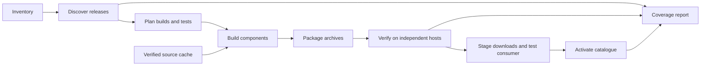

# Architecture

This document defines implementation responsibilities and data flow. [Implementation decisions](implementation-decisions.md) explain the technical choices and remaining research.

## Pipeline



Each stage preserves its input identities. The planner derives targets from upstream releases and inventory rules. Verification tests packaged bytes; publication distributes those same bytes. This prevents failed targets from disappearing and verified archives from being replaced by untested rebuilds.

## Responsibilities and source layout

Component recipes and platform adapters are separate dimensions. A recipe owns upstream source and version differences; an adapter owns compiler, loader and OS mechanics. Several SQL extensions from one source can share a build, then be packaged separately.

```text
spec/                         contract, profiles and decisions
components/
  postgresql/                 source intake and core recipe
  pgvector/                   extension recipe
  postgis/                    source recipe and SQL-extension packages
  address-standardizer/       standalone source recipe
  postgis-tiger-geocoder/     standalone source recipe
platforms/
  linux/                      toolchain, ABI and loader handling
  macos/                      SDK, Mach-O dependencies and signing
  windows/                    compiler and DLL runtime handling
packaging/                    file ownership, manifests, licences and hashes
catalog/                      discovery, coverage and download catalogue
tests/
  build/                      build checks and packaged smoke tests
  artifacts/                  independent archive verification
  consumer/                   reference download/run client
  sql/                        shared and extension-specific fixtures
.github/workflows/            orchestration of repository entry points
```

Create these boundaries as implementation needs them. Keep version selection, dependency handling and SQL fixtures shared rather than copying them into each platform script.

## Sources and versions

Fetch source archives on demand from authoritative upstream releases into a checksum-keyed cache. Keep archives and generated outputs out of Git; retain URLs, publication dates, tags, hashes, patches and recipe revisions as provenance. Verify cached content before use.

Prefer release tarballs containing the generated build files. For tag-based builds, record the commit and generation tools. Pin build and runtime dependencies before compiling so package-manager updates cannot silently change a rebuild.

Handle version differences through explicit recipe conditions or small, justified patches with applicable ranges. Separate recipes only where APIs or dependencies require it. This supports many source versions without duplicating whole scripts.

## Build planning and reuse

Plan core builds per exact PostgreSQL release/platform. Plan native extension builds per source release, PostgreSQL major, platform and dependency variant. The initial baseline strategy is the oldest eligible compatible minor in each major; [D03](implementation-decisions.md#d03--extension-build-reuse) explains why and its limits.

Test each candidate archive against every claimed runtime minor. Split the build range when an ABI or dependency difference requires it. SQL-only packages may share bytes across majors after verification.

Cache keys include sources, patches, PostgreSQL build target, architecture, compiler/SDK, dependencies, options and recipe revision. Changes invalidate affected builds and verification records. Develop shared recipes once; parallelize independent build tasks.

For `P` PostgreSQL releases, `T` platforms and `E` extension releases, naive packaging can require roughly `P × T × E` native extension artifacts. Reuse across minors can reduce this toward `M × T × E`, where `M` is the number of compatible PostgreSQL majors. The applicable runtime test matrix remains `P × T × E`; unrelated extension subsets add no targets.

## Packages and shared dependencies

Stage a standard PostgreSQL installation prefix. Extension archives provide overlays using the platform's expected control, SQL and library paths. Keep database data directories outside the installation payload and record platform-specific paths in manifests.

Collect all runtime dependencies: linked libraries, dynamically loaded plugins, helper executables and resources. Bundle or statically link non-OS dependencies, repair loader paths where needed, and resolve resources relative to the installation. Dependency scans and clean-host execution test different failure modes; use both.

Each SQL extension owns its control and SQL files. Explicit runtime packages can own shared libraries; core may own a small common dependency. Choose ownership from measured sizes and loading tests so optional geospatial libraries do not become mandatory core downloads. Size measurements guide internal packaging choices; publishing per-artifact sizes or selection totals is not a product requirement.

File manifests and the reference consumer reject conflicting contents at one destination. Required dependency combinations also need loading tests: separate paths cannot prevent all collisions between native library names or symbols in one process. Arbitrary unrelated extension combinations remain the application's responsibility under F08.

## Verification and publication

The [three test levels](testing/README.md) run in sequence: build checks, independent artifact checks, then consumer tests against staged downloads and a candidate catalogue. Activate the current catalogue only after these pass.

Include the full SHA-256 in every archive filename and URL. Upload those bytes before activating their catalogue entries; never replace content under an existing checksum-bearing name. Replacement builds require updated evidence and cache identities; retain compact provenance when superseded binaries are removed. Periodic download checks detect inaccessible current artifacts. Hosting remains a [review decision](product-decisions.md#download-hosting).

## Reference consumer and CI

The reference consumer accepts explicit PostgreSQL, platform and extension versions, including prerequisite selections supplied by its fixture. It reads the catalogue, downloads those artifacts and their native/shared-runtime packages, verifies and unpacks them, applies declared settings, and starts PostgreSQL. It executes supplied SQL or opens packaged `psql`, then cleans up its process and data directory. It supplies no SQL-extension dependency-version solver or automatic prerequisite-creation policy.

Its implementation language is open. It must use public metadata and standard tools, support native Windows without requiring a Unix environment, and avoid depending on build-tree files or SQL parsing. Detailed cases are in the [consumer tests](testing/consumer.md).

CI calls shared repository entry points and follows the [execution rules](testing/README.md#execution-rules): local binary work in Docker, standard free runners, scoped triggers, bounded timeouts and short binary-artifact retention. Missing test environments remain explicit coverage gaps.

## Next architectural experiments

Before fixing recipe interfaces, build an older selected PostgreSQL major, an older eligible extension line and the standalone source projects. Demonstrate extension reuse, separate PostGIS packages, operation without preinstalled non-OS runtimes, and measured download sizes. These experiments can refine adapters and file ownership while preserving the functional guarantees.
